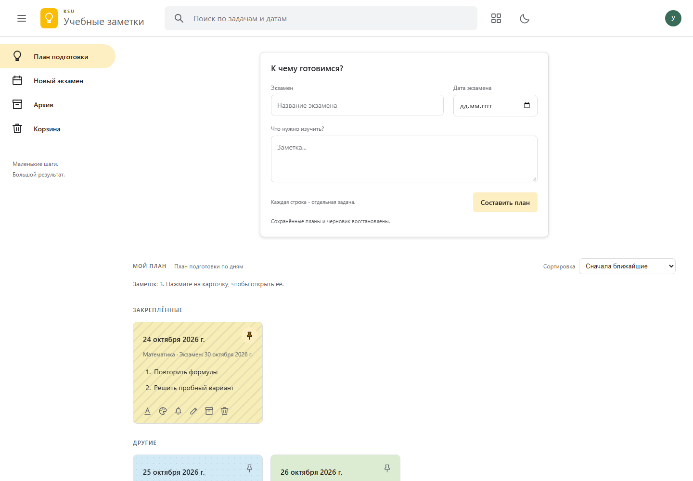
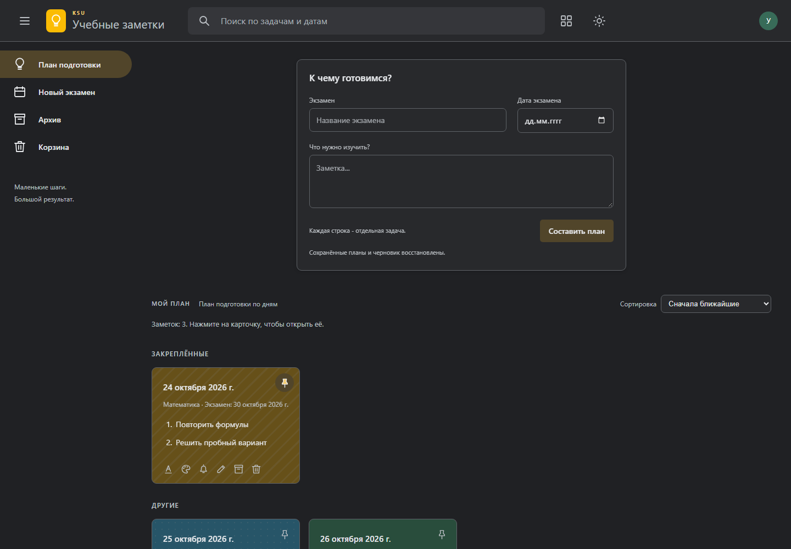

# KSU Study Notes — план подготовки к экзаменам

[](https://github.com/desk1qq/ksu-study-notes/actions/workflows/ci.yml)

Локальное веб-приложение распределяет учебные задачи по дням до экзамена. Работает без сервера и сторонних зависимостей, сохраняет заметки только в браузере через `localStorage`.

## Возможности

- равномерное распределение задач по календарным дням без пустых карточек;
- создание нескольких планов, поиск, сортировка и автоматическое сохранение изменений;
- закреплённые заметки, архив, корзина и восстановление;
- оформление карточек, локальные напоминания, светлая и тёмная темы;
- проверка пустых полей и некорректной даты с понятным сообщением.

## Интерфейс

Светлая тема:



Тёмная тема:



## Установка и запуск

Нужен современный Google Chrome или Microsoft Edge. Установка пакетов и сборка не требуются.

```powershell
git clone https://github.com/desk1qq/ksu-study-notes.git
cd ksu-study-notes
Start-Process .\keep.html
```

Также можно открыть `keep.html` двойным щелчком.

## Тесты

Запуск браузерных тестов:

```powershell
powershell -NoProfile -ExecutionPolicy Bypass -File tests/run-tests.ps1
```

Полная проверка, используемая в GitHub Actions:

```powershell
powershell -NoProfile -ExecutionPolicy Bypass -File scripts/check.ps1
```

Она проверяет обязательные файлы, отсутствие маркеров незавершённого слияния, валидацию, повреждённое хранилище, загрузку приложения и сценарий создания и поиска заметки.

## Как пользоваться

1. Введите название и будущую дату экзамена.
2. Добавьте задачи — по одной на строку.
3. Нажмите «Составить план».
4. Откройте карточку, чтобы изменить её: корректные данные сохраняются автоматически.
5. Используйте поиск, закрепление, архив или корзину для организации заметок.

## Хранение и алгоритм

Данные хранятся под ключом `exam-planner-v1` в `localStorage`. Очистка данных браузера удалит планы. Даты обрабатываются как календарные значения без смещения часового пояса.

Для `N` задач и `D` доступных дней каждый день получает `Math.floor(N / D)` задач, а первые `N % D` дней — ещё по одной. Порядок задач сохраняется. Если задач меньше, чем дней, пустые дни не создаются.

## Ограничения

- синхронизации между устройствами и серверного резервного копирования нет;
- напоминания отображаются только внутри открытой страницы;
- задачи считаются одинаковыми по трудоёмкости;
- поведение `localStorage` для `file://` зависит от браузера, поэтому следует использовать тот же браузер и путь к файлу.

## Лицензия

Проект распространяется по лицензии [MIT](LICENSE). В проекте нет сторонних программных зависимостей и заимствованных изображений; скриншоты созданы из самого приложения.
